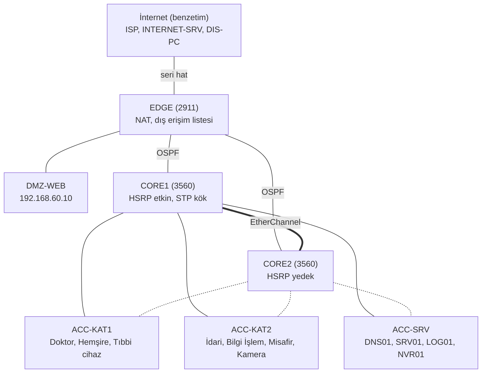
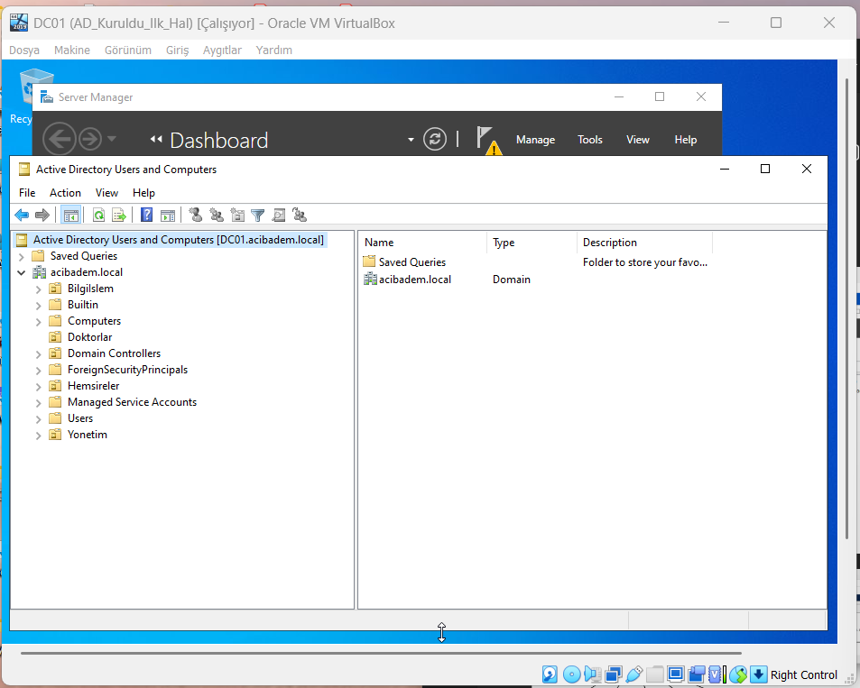

# Buhara Hastanesi Ağ ve Sunucu Altyapısı

Kurgusal bir hastane için tasarlanmış ağ ve sunucu altyapısı. İki ayrı bölümden oluşur:

- **Ağ (Cisco Packet Tracer 9.0.1):** bölümlere ayrılmış, yedekli çekirdeği, internet çıkışı ve DMZ'si olan bir yerleşke ağı. Kurallar hem benzetimde elle hem de bu depodaki bir araçla doğrulandı.
- **Sunucu (VirtualBox üzerinde Windows Server):** Active Directory, DNS ve Grup İlkesi.

Ders projesi olarak başladı; üçüncü sürümde (v3) ağ bölümü baştan tasarlandı.

> Bu bir benzetimdir. Buradaki sonuçlar gerçek bir ağın başarımı, güvenliği ya da herhangi bir standarda uyumu hakkında kanıt değildir. İki bölüm (Packet Tracer ve Windows Server) birbirine bağlı değildir.

## Sürümler

| Sürüm | Ne | Durum |
|---|---|---|
| **v3** (güncel) | İki çekirdek anahtar, üç erişim anahtarı, kenar yönlendirici, NAT, DMZ, 9 VLAN | Packet Tracer'da kuruldu ve sınandı: [`packet-tracer/buhara-v3.pkt`](packet-tracer/), [`configs/v3/`](configs/v3/) |
| v2 | v1'in düzeltilmiş yapılandırması | Yalnızca araçla denetlendi, Packet Tracer'a uygulanmadı: [`configs/v2/`](configs/v2/) |
| v1 | Tek yönlendirici, tek anahtar, 6 VLAN | Packet Tracer'da kuruldu: [`packet-tracer/buhara-hastanesi.pkt`](packet-tracer/), [`configs/v1/`](configs/v1/) |

v1 ve v2 tarihçe olarak saklanıyor: [`docs/onceki-surumler.md`](docs/onceki-surumler.md).

## v3 topolojisi



Ayrıntılı şema ve Packet Tracer görüntüsü: [`docs/v3/topoloji.md`](docs/v3/topoloji.md). Adresler: [`docs/v3/adres-plani.md`](docs/v3/adres-plani.md).

## Ne yapıldı

- **Bölümleme:** doktor, hemşire, idari, bilgi işlem, sunucu, tıbbi cihaz, kamera, misafir ve cihaz yönetimi ağları ayrı VLAN'larda. Varsayılan yasak: [erişim matrisinde](docs/v3/erisim-matrisi.md) yazmayan her bağlantı engellenir.
- **Yedeklilik:** iki çekirdek anahtar arasında HSRP ile paylaşılan ağ geçidi, erişim anahtarlarından çift uplink (Rapid PVST), çekirdekler arası EtherChannel, kenar yönlendiriciye OSPF ile çift yol.
- **İnternet ve DMZ:** personel ve misafir ağları NAT ile internete çıkar; dışarıdan yalnızca DMZ'deki web sunucusunun 80 ve 443 numaralı portları görünür.
- **Cihaz sıkılaştırma:** yalnızca SSH, yalnızca Bilgi İşlem ağından; kullanılmayan portlar kapalı; uç portlarda port güvenliği, PortFast ve BPDU Guard.
- **Kayıt ve saat:** ağ cihazları kayıtlarını merkezi bir sunucuya gönderir ve saatini oradan alır.
- **Doğrulama aracı:** [`tools/acl_check_v3.py`](tools/acl_check_v3.py) cihazlardan dışa aktarılan yapılandırmayı okur ve matristeki bütün bağlantıları (izinli olmayanlar dahil) yürütür.

Her seçimin gerekçesi ve bedeli: [`docs/v3/tasarim-kararlari.md`](docs/v3/tasarim-kararlari.md).

## İddialar ve kanıtları

| İddia | Nasıl doğrulandı | Kanıt |
|---|---|---|
| Doktor hasta bilgi sistemini açabilir; hemşire ve idari personel açamaz | Packet Tracer'da tarayıcıdan | [E1, E5, E7](docs/v3/test-sonuclari.md#erişim-kuralları) |
| Misafir ağı iç ağların hiçbirine ulaşamaz, internete çıkar | Ping ve tarayıcı | [E8, E9](docs/v3/test-sonuclari.md#erişim-kuralları) |
| Tıbbi cihazlar ve kameralar yalnızca kendi sunucularına bağlanır | Ping ve tarayıcı | [E10-E13](docs/v3/test-sonuclari.md#erişim-kuralları) |
| İç ağ internete NAT ile çıkar | EDGE çeviri tablosu | [N1-N3](docs/v3/test-sonuclari.md#nat-internet-ve-dmz) |
| Dışarıdan yalnızca web sitesi görünür; ping, SSH ve iç adresler kapalı | İnternet tarafındaki bilgisayardan | [N4-N7](docs/v3/test-sonuclari.md#nat-internet-ve-dmz) |
| DMZ sunucusu hiçbir yere bağlantı başlatamaz | DMZ sunucusundan ping | [N8](docs/v3/test-sonuclari.md#nat-internet-ve-dmz) |
| Cihazlar yalnızca SSH ile ve yalnızca Bilgi İşlem ağından yönetilir | Telnet, SSH (izinli ve izinsiz kaynaktan) | [Y1-Y5](docs/v3/test-sonuclari.md#cihaz-yönetimi) |
| Cihaz saatleri eşit, kayıtlar merkezi sunucuda | `show ntp status`, LOG01 kayıt listesi | [K1-K3](docs/v3/test-sonuclari.md#kayıt-ve-saat) |
| Bir çekirdek kapandığında trafik kendiliğinden sürer | Sürekli ping altında CORE1'in portları kapatıldı | [A1-A4](docs/v3/test-sonuclari.md#yedeklilik) |
| Bütün matris cihaz yapılandırmasıyla uyuşur (1109 deneme) | `tools/acl_check_v3.py` | [Araçla doğrulama](docs/v3/test-sonuclari.md#araçla-doğrulama) |
| Araç bozuk yapılandırmayı yakalar | 9 bozma testi | [`tests/test_acl_check_v3.py`](tests/test_acl_check_v3.py) |

Sınanmayanlar ve testlerde görülen tuhaflıklar da aynı sayfada yazılıdır: [test sonuçları](docs/v3/test-sonuclari.md#dürüstlük-notları).

## Çalıştırma

**Denetim aracı ve testler** (Python 3.10+, ek paket gerekmez):

```bash
python tools/acl_check_v3.py configs/v3 docs/v3/erisim-matrisi.json            # özet
python tools/acl_check_v3.py configs/v3 docs/v3/erisim-matrisi.json --ayrinti  # her deneme ve eşleşen kural
python tools/acl_check_v3.py configs/v3 docs/v3/erisim-matrisi.json --tablo    # erişim tablosu (Markdown)
python -m unittest discover -s tests
```

**Packet Tracer dosyası:**

1. `packet-tracer/buhara-v3.pkt` dosyasını Cisco Packet Tracer 9.0.1 ya da daha yenisiyle açın.
2. Bağlantıların oturması için yaklaşık bir dakika bekleyin (Spanning Tree, OSPF ve HSRP).
3. Bir uç cihazın **Desktop** sekmesinden komut satırını ya da tarayıcıyı açıp [test sonuçları](docs/v3/test-sonuclari.md) sayfasındaki denemeleri yineleyin. Açılıştan sonraki ilk paketler kaybolabilir; denemeyi bir kez daha yapın.
4. Bir ağ cihazının yapılandırmasını görmek için cihazın **Config** sekmesindeki dışa aktarma düğmesini kullanabilirsiniz; bunun için parola gerekmez.

**Parolalar:** `.pkt` dosyasındaki cihazlarda yalnızca bu benzetim için üretilmiş laboratuvar parolaları vardır; depoda yazılı değildir. `configs/v3/` altındaki dosyalarda parolaların yerinde `DEGISTIR_ENABLE_PAROLASI` ve `DEGISTIR_SSH_PAROLASI` yer tutucuları bulunur. Ağı sıfırdan kurmak için bu dosyaları kendi parolalarınızla boş cihazlara yapıştırın; cihaz modelleri, kablolama ve sunucu ayarları [adres planında](docs/v3/adres-plani.md) yazılıdır.

## Belgeler

| Belge | İçerik |
|---|---|
| [`docs/v3/topoloji.md`](docs/v3/topoloji.md) | Şema, katmanlar |
| [`docs/v3/adres-plani.md`](docs/v3/adres-plani.md) | VLAN'lar, adresler, portlar, DHCP havuzları |
| [`docs/v3/erisim-matrisi.md`](docs/v3/erisim-matrisi.md) | Kim nereye erişir, gerekçeleri, yapılandırmadan hesaplanan tablo |
| [`docs/v3/tasarim-kararlari.md`](docs/v3/tasarim-kararlari.md) | Her seçim: ne, neden, bedeli |
| [`docs/v3/test-sonuclari.md`](docs/v3/test-sonuclari.md) | Beklenen, gözlenen, kanıt; sınanmayanlar |
| [`docs/v3/sinirlamalar.md`](docs/v3/sinirlamalar.md) | Bilinen sınırlamalar, Packet Tracer'ın kabul etmediği komutlar |
| [`docs/onceki-surumler.md`](docs/onceki-surumler.md) | v1 ve v2 |

## Windows Server bölümü

Bu bölüm ilk sürümde kuruldu ve v3'te değiştirilmedi. Packet Tracer benzetimine bağlı değildir.

VirtualBox'ta çalışan bir Windows Server sanal makinesinde (DC01):

- **Active Directory:** her departman için bir yapısal birim (OU): `Doktorlar`, `Hemsireler`, `Yonetim`, `BilgiIslem`. Her birinde bir güvenlik grubu (`GRP_Doktorlar` vb.) ve bir örnek kullanıcı.
- **DNS:** etki alanı bölgesi; DC01 ve bir istemci (PC01) için kayıtlar.
- **Grup İlkesi:** Denetim Masası'na erişimi kapatan `GPO_ControlPanel_Kapat`.
- **Windows Server Backup** özelliği yüklü.



Bilinen eksikleri:

- Sanal makinedeki etki alanının adı `acibadem.local`'dır. Bu yalnızca bir laboratuvar adıdır; gerçek bir kurumla ilgisi yoktur. Packet Tracer tarafında kullanılan ad `buhara.local`'dır; ikisi henüz eşitlenmedi.
- Yedekleme zamanlanmadı: Windows Server Backup yüklü, ancak bir yedekleme planı tanımlı değil ve geri yükleme denenmedi ([ekran görüntüsü](docs/ekran-goruntuleri/25-windows-server-backup.png)).
- `GPO_ControlPanel_Kapat` etki alanı düzeyinde bağlı olduğundan Bilgi İşlem dahil bütün birimleri kapsar; yalnızca ilgili kullanıcı OU'larına bağlanması daha doğru olur.

## Sınırlamalar

En önemlileri (tam liste: [`docs/v3/sinirlamalar.md`](docs/v3/sinirlamalar.md)):

- Erişim listeleri durum bilgisi tutmaz; bölgeler arasında durum izleyen bir güvenlik duvarı yoktur.
- Aynı VLAN içindeki trafik süzülmez.
- Kenar yönlendirici, ISS bağlantısı ve sunucular yedeksizdir.
- Çekirdek arızasında geçiş kayıpsız değildir; ölçülen kayıplar test sonuçlarında yazılıdır.
- Packet Tracer bazı komutları kabul etmedi; yerine ne yapıldığı sınırlamalar sayfasındadır.

## Depo yapısı

```
packet-tracer/buhara-v3.pkt          v3 Packet Tracer dosyası
packet-tracer/buhara-hastanesi.pkt   v1 Packet Tracer dosyası (tarihçe)
configs/v3/                          v3: cihazlardan dışa aktarılan yapılandırmalar (parolasız)
configs/v1/, configs/v2/             önceki sürümler
docs/v3/                             v3 belgeleri, ekran görüntüleri ve konsol çıktıları
docs/onceki-surumler.md              v1 ve v2'nin anlatımı
docs/ekran-goruntuleri/              v1 ve Windows Server ekran görüntüleri
tools/acl_check_v3.py                v3 erişim kuralı denetimi (çok cihazlı, NAT dahil)
tools/acl_check.py                   v1/v2 denetimi (tek yönlendirici)
tools/yapilandirma_temizle.py        dışa aktarılan yapılandırmadan parola özetlerini çıkarır
tests/                               beklenti dosyaları ve birim testleri
```
