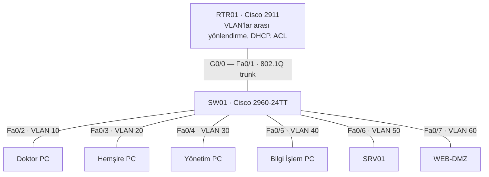
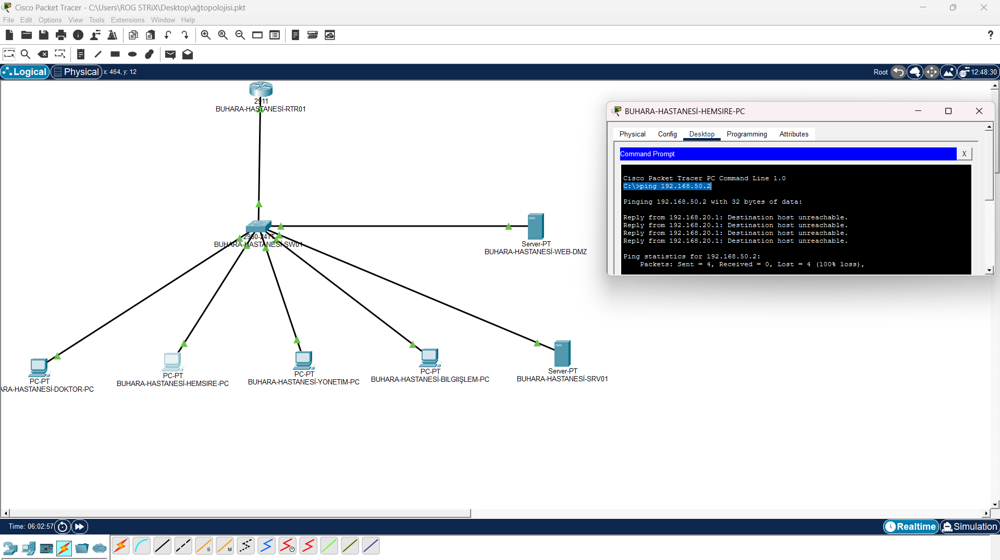

# Önceki sürümler: v1 ve v2

Bu sayfa, projenin ilk iki sürümünü olduğu gibi saklar. Güncel tasarım v3'tür ([ana sayfa](../README.md)). Buradaki metin v3'ten önce yazılmıştır; "ilk sürüm" v1, "ikinci sürüm" v2 demektir. Komutlar depo kökünden çalıştırılır.

v3 bu sayfadaki sınırlamaların çoğunu giderir: internet bağlantısı, yedeklilik ve Packet Tracer'da sınanmış kurallar artık vardır. Windows Server ile ilgili maddeler hâlâ geçerlidir.

## İki sürüm

Bu sayfa iki eski sürümü anlatır.

| | Nerede | Durum |
|---|---|---|
| **İlk sürüm** | [`packet-tracer/buhara-hastanesi.pkt`](../packet-tracer/), [`configs/v1/`](../configs/v1/) | Packet Tracer'da kuruldu ve denendi. Ekran görüntüleri bu sürüme ait. |
| **İkinci sürüm** | [`configs/v2/`](../configs/v2/) | İlk sürümün incelenmesinden sonra yazıldı. Erişim kuralları [`tools/acl_check.py`](../tools/acl_check.py) ile denetlendi; Packet Tracer'a henüz uygulanmadı. |

## Topoloji



## Adres planı

| VLAN | Ad | Ağ | Ağ geçidi | İlk sürüm | İkinci sürüm |
|---:|---|---|---|---|---|
| 10 | Doktorlar | 192.168.10.0/24 | 192.168.10.1 | DHCP | DHCP (.21 – .254) |
| 20 | Hemşireler | 192.168.20.0/24 | 192.168.20.1 | DHCP | DHCP (.21 – .254) |
| 30 | Yönetim | 192.168.30.0/24 | 192.168.30.1 | DHCP | DHCP (.21 – .254) |
| 40 | Bilgi İşlem | 192.168.40.0/24 | 192.168.40.1 | DHCP | DHCP (.21 – .254); SW01 yönetim adresi .2 |
| 50 | Sunucular | 192.168.50.0/24 | 192.168.50.1 | DHCP (SRV01 .2 aldı) | Sabit: SRV01 .2, DC01 .10 |
| 60 | DMZ | 192.168.60.0/24 | 192.168.60.1 | DHCP (WEB-DMZ .6 aldı) | Sabit: WEB-DMZ .10 |

DC01, Windows Server sanal makinesinin plandaki adresidir; Packet Tracer topolojisinde bir cihaz olarak yer almaz.

## İlk sürüm

Kurulan ve Packet Tracer'da denenenler:

- Altı VLAN ve erişim portları; yönlendiriciye tek trunk bağlantısı.
- Yönlendiricide her VLAN için bir alt arayüz ve bir DHCP havuzu.
- Tek erişim kuralı: Hemşireler ağından SRV01'e (192.168.50.2) erişim kapalı.

| Deneme | Sonuç | Kanıt |
|---|---|---|
| Doktor PC → SRV01 ping | Başarılı | [13](ekran-goruntuleri/13-doktor-sunucu-ping.png) |
| Hemşire PC → SRV01 ping | Engellendi | [14](ekran-goruntuleri/14-hemsire-sunucu-engel.png) |
| Bütün cihazlar DHCP'den adres aldı | Başarılı | [06](ekran-goruntuleri/06-dhcp-kiralamalari.png) |



Bütün ekran görüntüleri [`docs/ekran-goruntuleri/`](ekran-goruntuleri/) klasöründedir.

### İlk sürümün eksikleri ve ikinci sürümdeki düzeltmeler

| İlk sürümde | Sonucu | İkinci sürümde |
|---|---|---|
| DMZ havuzu DNS sunucusu olarak 192.168.10.10 dağıtıyor; diğer havuzlar 192.168.50.10 | Adres, Doktorlar havuzundan herhangi bir bilgisayara verilebilir | Bütün havuzlar 192.168.50.10 dağıtır |
| Sunucular adreslerini DHCP'den alıyor; erişim kuralı ise sabit bir adrese (192.168.50.2) yazılmış | Sunucunun adresi değişirse kural boşa düşer | Sunucular sabit adresli; sunucu ve DMZ ağlarında DHCP havuzu yok |
| Departmanlar arasında kural yok | Doktor, Hemşire ve Yönetim ağları birbirine erişebiliyor | Bu üç ağ birbirine ve Bilgi İşlem ağına bağlantı başlatamaz |
| DMZ için kural yok | DMZ'deki sunucu bütün iç ağlara erişebiliyor | DMZ iç ağlara bağlantı başlatamaz; yalnızca gelen bağlantılara yanıt verir |
| Parola, SSH ve oturum zaman aşımı yok | Konsola bağlanan herkes cihazı yönetebilir | Yerel kullanıcı, `enable secret`, yalnızca SSH, yalnızca Bilgi İşlem ağından |
| Trunk bütün VLAN'ları taşıyor, native VLAN 1; boş portlar açık ve VLAN 1'de | Boş bir porta takılan cihaz ağa girer | Trunk yalnızca altı VLAN'ı taşır, native VLAN boş bir VLAN; boş portlar kapalı |
| Uç portlarda koruma yok | Porta ikinci bir cihaz ya da anahtar bağlanabilir | Port güvenliği (tek MAC), PortFast ve BPDU Guard |
| Yönlendiricinin adı `BUHARA-CORE-SW01`, anahtarın adı `Switch` | Ekran görüntülerindeki adla (`BUHARA-HASTANESI-RTR01`) uyuşmuyor | `BUHARA-RTR01`, `BUHARA-SW01` |

## Erişim kuralları

Tablolar, ilgili yapılandırma dosyasından `tools/acl_check.py --matrix` ile üretildi.
✓: ping başarılı (istek gider, yanıt döner). ✗: engellenir.

**İlk sürüm**

| Kaynak \ Hedef | DOKTOR-PC | HEMSIRE-PC | YONETIM-PC | BILGIISLEM-PC | SRV01 | WEB-DMZ |
|---|:---:|:---:|:---:|:---:|:---:|:---:|
| **DOKTOR-PC** | – | ✓ | ✓ | ✓ | ✓ | ✓ |
| **HEMSIRE-PC** | ✓ | – | ✓ | ✓ | ✗ | ✓ |
| **YONETIM-PC** | ✓ | ✓ | – | ✓ | ✓ | ✓ |
| **BILGIISLEM-PC** | ✓ | ✓ | ✓ | – | ✓ | ✓ |
| **SRV01** | ✓ | ✗ | ✓ | ✓ | – | ✓ |
| **WEB-DMZ** | ✓ | ✓ | ✓ | ✓ | ✓ | – |

**İkinci sürüm**

| Kaynak \ Hedef | DOKTOR-PC | HEMSIRE-PC | YONETIM-PC | BILGIISLEM-PC | DC01 | SRV01 | WEB-DMZ |
|---|:---:|:---:|:---:|:---:|:---:|:---:|:---:|
| **DOKTOR-PC** | – | ✗ | ✗ | ✗ | ✓ | ✓ | ✓ |
| **HEMSIRE-PC** | ✗ | – | ✗ | ✗ | ✓ | ✗ | ✓ |
| **YONETIM-PC** | ✗ | ✗ | – | ✗ | ✓ | ✓ | ✓ |
| **BILGIISLEM-PC** | ✓ | ✓ | ✓ | – | ✓ | ✓ | ✓ |
| **DC01** | ✓ | ✓ | ✓ | ✓ | – | ✓ | ✓ |
| **SRV01** | ✓ | ✗ | ✓ | ✓ | ✓ | – | ✓ |
| **WEB-DMZ** | ✗ | ✗ | ✗ | ✗ | ✗ | ✗ | – |

İkinci sürümün kuralları:

- Bütün kullanıcı ağları DC01'e (DNS, oturum açma) erişir.
- SRV01'e Doktorlar, Yönetim ve Bilgi İşlem erişir; Hemşireler erişemez.
- Kullanıcı ağları DMZ'deki web sunucusuna yalnızca web (80, 443) ve ping ile erişir.
- Bilgi İşlem, destek ve yönetim için bütün ağlara erişir.
- Kurallar her ağın yönlendiriciye giriş yönünde uygulanır; listeler açık bir `deny ip any any` ile biter.

## Kuralların denetimi

`tools/acl_check.py`, yönlendirici yapılandırmasını okuyup bir beklenti dosyasındaki
her bağlantıyı kurallar üzerinde yürütür: paket hangi arayüzden girer, hangi kuralla
eşleşir, yanıt geri dönebilir mi. Ayrıca DHCP havuzlarını denetler; örneğin ilk
sürümdeki DNS adresi hatasını bulur.

```bash
python tools/acl_check.py configs/v2/RTR01.cfg tests/beklentiler_v2.json --matrix
```

```
TAMAM  DOKTOR-PC -> SRV01 ping: geçti  [DOKTORLAR-GIRIS: permit ip 192.168.10.0 0.0.0.255 host 192.168.50.2]
TAMAM  HEMSIRE-PC -> SRV01 ping: engellendi  [istek engellendi - HEMSIRELER-GIRIS: deny ip any any]
TAMAM  WEB-DMZ -> DC01 udp/53: engellendi  [sorgu engellendi - DMZ-GIRIS: deny ip any any]
...
73/73 deneme beklendiği gibi, 0 DHCP uyarısı
```

Aynı beklentiler ilk sürümde çalıştırıldığında 26'sı tutmaz:

```bash
python tools/acl_check.py configs/v1/RTR01.cfg tests/beklentiler_v2.json
```

Testler (Python 3.10+, ek paket gerekmez):

```bash
python -m unittest discover -s tests
```

Testler betiğin kendisini, ilk sürümde modelin ekran görüntülerindeki sonuçları
vermesini ve ikinci sürümde yönlendirici ile anahtar dosyalarının birbiriyle
tutarlı olmasını (trunk'taki VLAN'lar, native VLAN, sabit adreslerin DHCP dışında kalması) denetler.

Betik bir IOS benzetimi değildir: yalnızca doğrudan bağlı ağlar arasındaki
yönlendirmeyi ve ACL eşleştirmesini modeller.

## İkinci sürümü Packet Tracer'da çalıştırma

1. `packet-tracer/buhara-hastanesi.pkt` dosyasının bir kopyasını açın.
2. `configs/v2/` altındaki iki dosyada `DEGISTIR_` ile başlayan parolaları değiştirin.
3. Yönlendiricide: `enable`, `erase startup-config`, `reload`. Açılışta kurulum
   sihirbazına `no` deyin; `enable`, `configure terminal` ve `RTR01.cfg` içeriğini yapıştırın.
4. Anahtarda: `enable`, `erase startup-config`, `delete vlan.dat`, `reload`;
   ardından `configure terminal` ve `SW01.cfg` içeriğini yapıştırın.
5. Sunuculara sabit adres verin:
   SRV01 192.168.50.2 / 255.255.255.0, ağ geçidi 192.168.50.1, DNS 192.168.50.10;
   WEB-DMZ 192.168.60.10 / 255.255.255.0, ağ geçidi 192.168.60.1.
6. Bilgisayarlarda DHCP'yi yenileyin, iki cihazda `copy running-config startup-config` çalıştırın.
7. `tests/beklentiler_v2.json` içindeki denemeleri (ping, web tarayıcı, SSH) cihazlardan tekrarlayın.

## İlk iki sürümün sınırlamaları

- **İki bölüm birbirine bağlı değil.** Packet Tracer benzetimi ile Windows Server
  sanal makinesi ayrı ortamlardır. DC01 sanal ağda 192.168.10.10 adresini
  kullanır; adres planındaki yeri 192.168.50.10'dur.
- **İkinci sürüm Packet Tracer'da denenmedi.** Kuralların mantığı betikle
  denetlendi; komutların cihazda kabul edildiği ve sonuçların aynı çıktığı ayrıca doğrulanmalıdır.
- **İnternet bağlantısı yok.** Topolojide dış ağ, NAT ya da güvenlik duvarı
  bulunmuyor; DMZ yalnızca iç ağlardan ayrılmış bir sunucu ağıdır.
- **Kurallar durum bilgisi tutmaz.** Yanıt trafiği `established` anahtar sözcüğü
  ve ICMP türüyle ayırt edilir; gerçek bir ağda bu iş için güvenlik duvarı kullanılır.
- **Yedeklilik yok.** Tek yönlendirici, tek anahtar ve tek trunk bağlantısı var.
- **Yedekleme zamanlanmadı.** Windows Server Backup yüklü, ancak bir yedekleme
  planı tanımlı değil ([ekran görüntüsü](ekran-goruntuleri/25-windows-server-backup.png)).
- **Grup ilkesi etki alanı düzeyinde bağlı.** `GPO_ControlPanel_Kapat` bu hâliyle
  Bilgi İşlem dahil bütün birimleri kapsar; yalnızca ilgili kullanıcı OU'larına bağlanması daha doğru olur.
