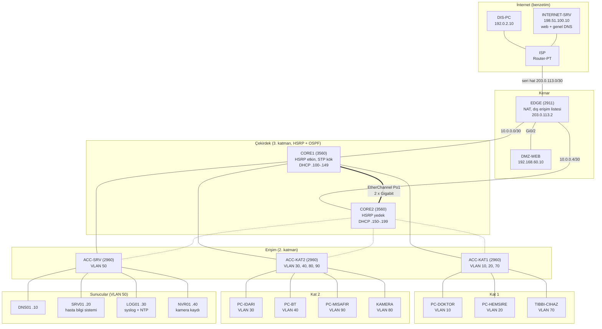
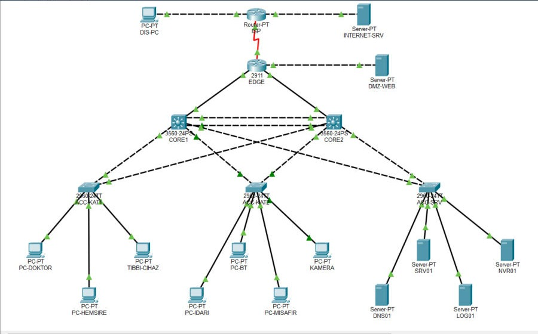

# Topoloji (v3)

## Şema

Kesikli çizgiler, erişim anahtarlarının ikinci çekirdeğe (CORE2) giden yedek hatlarıdır. Her erişim anahtarı iki çekirdeğe de bağlıdır; aradaki döngüyü Spanning Tree (STP) keser. STP, anahtarlar arasındaki yedek kabloların döngü oluşturmasını önlemek için bir yolu bekletir ve asıl yol kesilince onu açar. CORE1 bütün VLAN'larda kök anahtar olacak şekilde ayarlanmıştır (öncelik 4096; CORE2 8192). ACC-KAT1'de VLAN 10 için doğrulandı: CORE1'e giden port `Root FWD`, CORE2'ye giden port `Altn BLK` ([kanıt](kanit/acc-kat1-stp-port-guvenligi.txt)). Diğer iki erişim anahtarında aynı denetim yapılmadı.

## Packet Tracer görünümü

Görüntü, `packet-tracer/buhara-v3.pkt` dosyası açıldıktan ve bağlantılar oturduktan sonra alınmıştır.

## Katmanlar ve görevleri

| Katman | Cihazlar | Görev |
|---|---|---|
| İnternet (benzetim) | ISP, INTERNET-SRV, DIS-PC | Hastane dışını temsil eder; NAT'ı ve dışarıdan erişimi sınamak için vardır |
| Kenar | EDGE, DMZ-WEB | Adres çevirisi (NAT), dışarıdan gelen trafiğin süzülmesi, dışa açık sunucunun iç ağdan ayrılması |
| Çekirdek | CORE1, CORE2 | VLAN'lar arası yönlendirme, erişim listeleri, ağ geçidi yedekliliği (HSRP), DHCP |
| Erişim | ACC-KAT1, ACC-KAT2, ACC-SRV | Uç cihazların bağlandığı portlar, port güvenliği |

Adresler ve port eşlemeleri için bkz. [adres planı](adres-plani.md).
